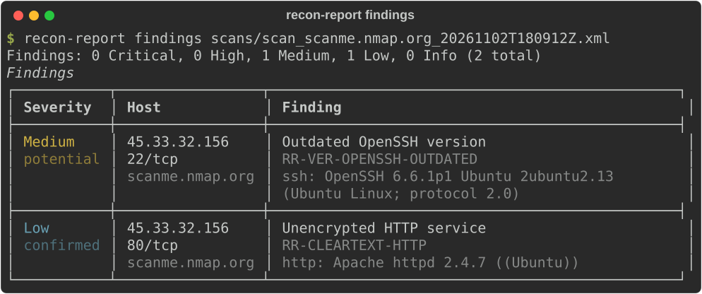
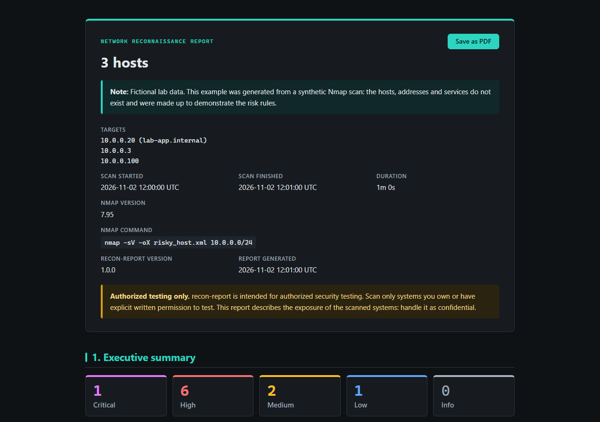
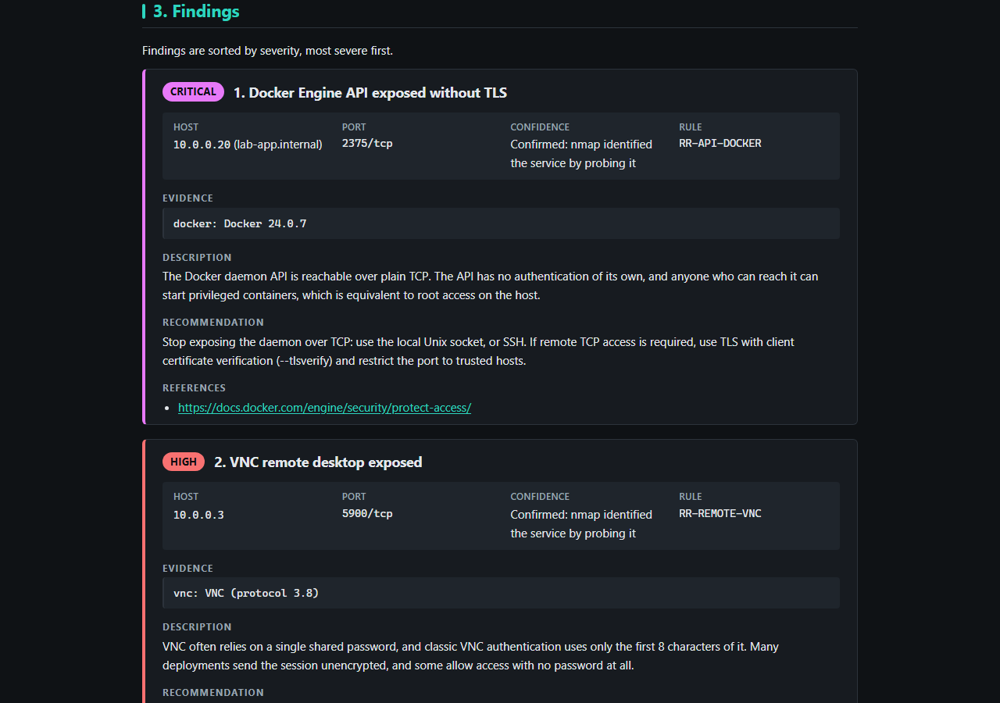
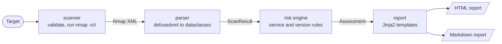

# recon-report

[](https://github.com/senura111/recon-report/actions/workflows/ci.yml)

[](LICENSE)

`recon-report` runs Nmap service discovery against a host you are authorized to
test, rates the exposed services, and writes findings reports in HTML and Markdown.



**View a sample report:**
[lab-risky-host](https://senura111.github.io/recon-report/examples/lab-risky-host.html)
(fictional lab data, 10 findings) ·
[scanme.nmap.org](https://senura111.github.io/recon-report/examples/scanme.html)
(a real scan) · Markdown versions: [lab-risky-host](examples/lab-risky-host.md),
[scanme](examples/scanme.md)

> **Authorized use only.** Scan only systems you own or have explicit written
> permission to test, such as your own lab VMs or
> [`scanme.nmap.org`](http://scanme.nmap.org/).

## Features

- **One-command scans:** runs `nmap -sV` against a single, validated target and
  saves the XML with a timestamped name.
- **Risk rating:** 22 rules flag cleartext and legacy protocols, exposed remote
  administration, databases and management APIs, and outdated or known-vulnerable
  versions. Each finding has a severity and a confidence level.
- **Reports:** a self-contained HTML report (dark on screen, ink-friendly when
  printed or saved as PDF) and a Markdown report, both with an executive summary,
  open ports per host, one card per finding and a methodology section.
- **CI gate:** `findings --fail-on high` exits with code 3 when a finding is at or
  above the threshold.
- **Safe with untrusted input:** scan data is never trusted, in the terminal, the
  XML parser or the reports (see [Security design](#security-design)).

## Quick start

You need Python 3.10 or later and [Nmap](https://nmap.org/download.html) on your
`PATH`. Nmap is only needed for `scan`; the other commands work on existing XML
files.

| Platform | Install Nmap |
|---|---|
| Windows | Run the installer from [nmap.org/download](https://nmap.org/download.html) |
| Debian / Ubuntu | `sudo apt install nmap` |
| Fedora | `sudo dnf install nmap` |
| macOS | `brew install nmap` |

**Windows (PowerShell):**

```powershell
git clone https://github.com/senura111/recon-report.git
cd recon-report
py -m venv .venv
.venv\Scripts\Activate.ps1
python -m pip install .
recon-report --version
```

**Linux / macOS:**

```bash
git clone https://github.com/senura111/recon-report.git
cd recon-report
python3 -m venv .venv
source .venv/bin/activate
python -m pip install .
recon-report --version
```

To work on the code, install with `python -m pip install -e ".[dev]"` instead.

## Usage

| Command | What it does |
|---|---|
| `scan TARGET` | Runs an Nmap service version scan and prints the open ports |
| `parse XML` | Prints the hosts and open ports in an Nmap XML file |
| `findings XML` | Rates the services and prints findings, most severe first |
| `report XML` | Writes an HTML and/or Markdown findings report |

Run `recon-report COMMAND --help` for every option.

### scan

```bash
recon-report scan scanme.nmap.org --ports 22,80
recon-report scan 192.168.56.10 --ports 1-1024 --timeout 300 --output scans
recon-report scan scanme.nmap.org --ports 22,80 --report both --report-dir reports
```

The XML is saved to `scans/` as `scan_<target>_<timestamp>.xml`. `--report`
writes a report straight after the scan.

### parse

```bash
recon-report parse scans/scan_scanme.nmap.org_20261102T180912Z.xml
```

### findings

```bash
recon-report findings scans/scan_scanme.nmap.org_20261102T180912Z.xml
```

### report

```bash
recon-report report scan.xml                        # HTML, written to reports/
recon-report report scan.xml --format both --output out
```

`--format` is `html` (default), `md` or `both`. Reports get timestamped names such
as `report_scanme.nmap.org_20261102T180924Z.html`, and existing files are never
overwritten.





### Failing a CI build with --fail-on

Use `--fail-on` to fail a pipeline when a scan of your own infrastructure turns up
a serious finding:

```bash
recon-report findings scan.xml --fail-on high
```

| Exit code | Meaning |
|---|---|
| 0 | Success, and no finding at or above `--fail-on` |
| 1 | The scan failed, or the XML file could not be read or parsed |
| 2 | Invalid arguments, e.g. an invalid target or unknown severity |
| 3 | At least one finding at or above `--fail-on` |

## How it works



- **scanner** validates the target and ports, then runs Nmap with an argument list
  and a timeout.
- **parser** turns the XML into dataclasses. Everything after this step works
  without Nmap, so the tests use XML fixtures.
- **risk engine** matches each open port against the rules in
  [`risk/rules.py`](src/recon_report/risk/rules.py) and returns sorted findings
  and severity counts.
- **report** renders the findings with Jinja2 templates.

## Security design

Hostnames, banners and versions come from the network, and XML files may come from
anyone, so all of it is treated as untrusted.

- **Argument injection:** Nmap runs with an argument list (never `shell=True`) and
  a timeout. Targets starting with `-` are rejected, so a target cannot become an
  Nmap option.
- **Single-target validation:** a target must be exactly one IPv4 address, IPv6
  address or hostname. Ranges, CIDR blocks, lists and wildcards are rejected, so
  a typo cannot widen a scan. Port specifications are validated too.
- **XML parsing (XXE):** XML is parsed with
  [defusedxml](https://pypi.org/project/defusedxml/), which rejects entity
  declarations (billion laughs) and external references (XXE).
- **Terminal output:** scan values are wrapped in rich `Text` objects, so a banner
  containing `[bold]`-style markup is printed literally.
- **HTML reports:** every value is escaped by Jinja2 autoescaping. The report is a
  single file with no external requests, and its Content-Security-Policy allows
  only the inline stylesheet and script by SHA-256 hash (`default-src 'none'`,
  never `'unsafe-inline'`).
- **Markdown reports:** values have all ASCII punctuation backslash-escaped and are
  kept on one line, so they cannot break tables or inject links, formatting or HTML.

To report a vulnerability, see [SECURITY.md](SECURITY.md).

## Risk rules

| Rule ID | Severity | Detects |
|---|---|---|
| `RR-API-DOCKER` | Critical | Docker Engine API over plain TCP |
| `RR-CLEARTEXT-TELNET` | High | Telnet |
| `RR-CLEARTEXT-RSERVICES` | High | rlogin, rsh or rexec |
| `RR-REMOTE-RDP` | High | Remote Desktop (RDP) |
| `RR-REMOTE-VNC` | High | VNC |
| `RR-REMOTE-SMB` | High | SMB or NetBIOS file sharing |
| `RR-DB-MONGODB` | High | MongoDB |
| `RR-DB-REDIS` | High | Redis |
| `RR-DB-ELASTICSEARCH` | High | Elasticsearch REST API |
| `RR-VER-APACHE-PATH-TRAVERSAL` | High | Apache httpd 2.4.49 / 2.4.50 (CVE-2021-41773, CVE-2021-42013) |
| `RR-VER-VSFTPD-BACKDOOR` | High | vsftpd 2.3.4 (CVE-2011-2523) |
| `RR-API-DOCKER-TLS` | Medium | Docker Engine API over TLS |
| `RR-CLEARTEXT-FTP` | Medium | Plain FTP |
| `RR-DB-MYSQL` | Medium | MySQL or MariaDB |
| `RR-DB-POSTGRESQL` | Medium | PostgreSQL |
| `RR-DB-MSSQL` | Medium | Microsoft SQL Server |
| `RR-VER-OPENSSH-OUTDATED` | Medium | OpenSSH older than 7.4 |
| `RR-VER-APACHE-EOL` | Medium | Apache httpd 2.2 or older |
| `RR-VER-IIS-EOL` | Medium | IIS older than 10.0 (end-of-life Windows Server) |
| `RR-VER-MYSQL-EOL` | Medium | MySQL older than 8.4 |
| `RR-VER-POSTGRESQL-EOL` | Medium | PostgreSQL 13 or older |
| `RR-CLEARTEXT-HTTP` | Low | Plain HTTP, when no more specific rule matched |

Every finding includes evidence, a description, a recommendation and, where
available, links to official vendor or project pages. Version thresholds were
checked against official lifecycle pages; each version rule records its review date.

### Confidence levels

| Confidence | Meaning |
|---|---|
| `confirmed` | Nmap identified the service by probing it |
| `likely` | Nmap guessed the service from the port number only |
| `potential` | Inferred from a banner version (all version rules) |

Version findings are always `potential`, because Linux distributions often
backport security fixes without changing the version in the banner.

## Testing and quality

- **387 tests** with pytest, all using XML fixtures, so Nmap is never run. They
  include malicious fixtures (XXE, billion laughs, markup in banners) and checks
  that the committed examples match the current templates.
- **Coverage gate:** CI fails below 99% line and branch coverage.
- **Lint and format:** ruff.
- **CI matrix:** Ubuntu and Windows × Python 3.10, 3.11, 3.12, 3.13 and 3.14, plus
  a job that builds the wheel and sdist and checks the templates are packaged.
  Actions are pinned to commit SHAs.
- **Dependabot** keeps pip and GitHub Actions dependencies up to date, with a
  7-day cooldown so only releases that have been public for a week are proposed.

```bash
pytest --cov=recon_report
ruff check . && ruff format --check .
```

To regenerate the examples and screenshots after changing templates or rules, run
`python scripts/generate_examples.py` and
`python scripts/generate_screenshots.py --report-png`.

## Limitations and responsible use

- **Authorized targets only.** Use `recon-report` only on systems you own or have
  explicit written permission to test. Unauthorized scanning may be illegal and
  may breach your provider's terms of service.
- **Banner-based version findings.** Version rules compare the version Nmap reads
  from a banner. Backported patches can make a patched service look outdated, and
  a changed or hidden banner can hide an outdated one. Confirm before acting.
- **Exposure, not exploitation.** Findings describe what is reachable. The tool
  does not test credentials, exploit anything or verify configuration, such as
  whether a database requires authentication.
- **One host per scan.** `scan` takes a single target by design. To assess a
  network, scan hosts individually or run Nmap yourself and feed the XML to
  `findings` and `report`.

## Built with

Developed with [Claude Code](https://claude.com/claude-code), Anthropic's agentic
coding tool, as an AI pair programmer.

## License

MIT. See [LICENSE](LICENSE).
